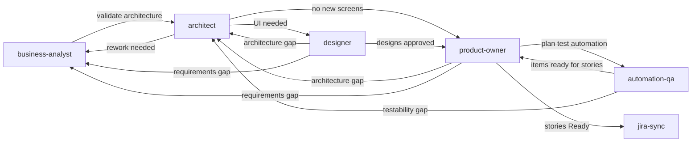

# Copilot Instructions

## About This Repository

This is **Sdlc.Planner**, a reusable AI harness that tracks a project's initiation context, requirements, architecture, and user stories. All of this content lives under `docs/` (see [docs/readme.md](../docs/readme.md) for the full guide); the repo root also holds `src/` (the actual codebase) alongside this `.github/` folder:

- [docs/pid.md](../docs/pid.md) — Project Initiation Document: fill this in first for a new project (background, objectives, scope, stakeholders, constraints). A one-time snapshot, not a living doc.
- [docs/project-overview.md](../docs/project-overview.md) — high-level entry point: a living summary of the project, seeded from `docs/pid.md`, before drilling into the detailed docs below.
- `docs/reqs/` — one Markdown file per application domain, describing what that part of the system needs to do. See [docs/reqs/readme.md](../docs/reqs/readme.md).
- `docs/architecture.md` — the current technical architecture, kept in sync with `docs/reqs/`.
- [docs/proposals/](../docs/proposals/readme.md) — isolated sandboxes for ideas still being brainstormed (one folder per idea). Nothing in `docs/proposals/` is real or approved; the real docs and Jira stay clean until the **proposals** agent promotes an approved proposal.
- [docs/technical-decisions/](../docs/technical-decisions/readme.md) — one file per significant technical decision (date-based IDs, no sequential numbers, so branches don't conflict); `Accepted` entries are constraints the architect and business-analyst agents must not silently contradict.
- [docs/risk-log/](../docs/risk-log/readme.md) — one file per project risk (Business/Technical/Delivery/Compliance), each tracked with status and mitigation; seeded from `docs/pid.md`'s initial `Risks` section.
- `docs/userstories/` — user stories derived from `docs/reqs/` and `docs/architecture.md`, organized by domain.
- `docs/qa/` — one automation QA plan per domain (`docs/qa/<domain>.md`), listing candidate test-automation work items for the product-owner to turn into enabler stories. Covers automation-layer concerns only (harness, CI, test data, testability hooks, E2E/API suites, visual regression, perf smoke) — never developer unit tests.

## Dedicated Agents

Seven custom agents drive the actual workflows here (see the agents dropdown in the Chat view), each scoped to one stage of the pipeline:

- **proposals** — manages isolated brainstorming workspaces under `docs/proposals/<slug>/`: create, list, share, discard, and (only on your explicit approval) promote into the real docs. Ask it to create or switch to a proposal and it becomes the active one (`docs/proposals/.active`, git-ignored); every agent then writes only inside that sandbox and prefixes replies with `Proposal: <slug>` until you tell the proposals agent to leave it, so real docs, designs, stories, risks and Jira stay clean.
- **business-analyst** — turns a raw idea into structured requirements under `docs/reqs/`, following [docs/reqs/_template.md](../docs/reqs/_template.md), checking feasibility and flagging gaps/dependencies.
- **architect** — reads `docs/reqs/`, validates requirements, and creates/updates `docs/architecture.md`.
- **designer** — reads `docs/reqs/` and `docs/architecture.md`, and designs screens/shared components as HTML+Tailwind mockups under `docs/designs/`, maintaining `docs/designs/design.md` as the brand & UI system reference. Runs before the product-owner for any domain with a UI, so stories can reference approved designs.
- **product-owner** — reads `docs/reqs/`, `docs/architecture.md`, and any approved `docs/designs/`, and drafts/updates stories under `docs/userstories/` following [.github/instructions/user-stories.instructions.md](instructions/user-stories.instructions.md).
- **automation-qa** — runs after the product-owner's first pass: reads the domain's drafted stories and writes a test-automation plan to `docs/qa/<domain>.md`. It only plans automation-layer work (Playwright E2E/visual, backend API/contract suites, harness, CI wiring, test data, testability hooks, perf smoke) and never writes stories or touches a story's acceptance criteria or test case requirements — those describe developer-owned unit tests.
- **jira-sync** — syncs `Status: Ready`+ stories from `docs/userstories/` into Jira (configured in `jira-sync.agent.md`) as Stories with per-domain Epics and Sub-tasks, and pulls issue status back into the story files. Never authors or edits story content.

Prefer switching to the relevant agent for requirements, architecture, design, story, or Jira-sync work rather than doing it in the default agent, so the right tool scope and workflow apply.

### Recommended workflow

Each agent's chat response offers handoff buttons to the next stage — follow them rather than manually switching agents, so the right context carries over:

Automation planning is a round trip: the product-owner drafts the domain's feature stories, `automation-qa` plans the suite against those real stories, and the product-owner then drafts one enabler story per automation item before syncing the domain to Jira.

Design is the default next step after architecture for any domain with a UI, but not a hard gate — the architect can hand off straight to the product-owner for backend/infra-only domains (e.g. CI/CD pipeline or project-scaffolding stories) that have no screens.

## General Conventions

- Never silently assume missing details. Flag assumptions in your response and document them in the affected file (`docs/architecture.md`'s Assumptions section, or a story's `Notes:` section).
- Keep [docs/project-overview.md](../docs/project-overview.md) up to date. It's a high-level view for general understanding of the project, from which someone can drill down into `docs/reqs/`, `docs/architecture.md`, `docs/designs/`, or `docs/userstories/`. Each agent keeps its own slice of it current as part of its own Workflow (see each `.github/agents/*.agent.md`): business-analyst maintains the Domains table's `Purpose`/`Requirements` cells, the Key Features by Domain section, and the `docs/reqs/` Status bullet; architect maintains the `Architecture` column, Architecture at a Glance, and the architecture/technical-decisions Status bullets; designer maintains the `Designs` column and its Status bullet; product-owner maintains the `Stories` column and its Status bullet; automation-qa maintains the `docs/qa/` Status bullet; jira-sync maintains the Jira Status bullet.

- Keep `docs/technical-decisions/` and `docs/risk-log/` clean: they describe current truth and git holds the history. When a decision is reversed back to an earlier one, reinstate the earlier entry and delete the unneeded intermediate ones; merge duplicate risks and drop obsolete closed ones. Confirm any deletion with the user first (see each folder's `readme.md`).
- Each agent keeps its own area tidy as it works — removing or renaming obsolete files (via `git mv`/`git rm`, after confirming deletions) and fixing links to them — and flags stale references in another agent's area rather than editing it. Agents use the terminal only for these file moves/deletes.

- Use Mermaid diagrams in `docs/architecture.md` to illustrate data flow, system boundaries, and relationships between domains. Keep diagrams consistent with the prose.

## Testing Framework

- Use NUnit as the .NET test framework. Prefer NUnit over xUnit/MSTest when adding or scaffolding test projects.

<!-- mermaid-ai-skills:start -->
## Mermaid Diagrams

When the user asks to create, edit, or visualize a diagram, follow the
instructions in `.github/instructions/mermaid.instructions.md`.
<!-- mermaid-ai-skills:end -->
