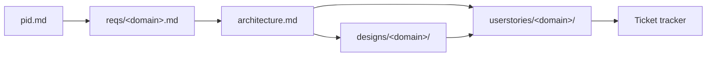

# Project Overview

*Start here after [pid.md](pid.md).* This is the living entry point for the project — a stakeholder-level summary of where things stand, and a basic user guide to the rest of the documentation set so anyone (technical or not) can find what they need: [reqs/](reqs/) for detailed domain requirements, [architecture.md](architecture.md) for technical design, [designs/](designs/) for approved screen mockups, [technical-decisions/](technical-decisions/readme.md) for the "why" behind key choices, [userstories/](userstories/) for what's being delivered.

> This file is seeded from [pid.md](pid.md) and then kept up to date by whichever agent's change affects the big picture — primarily **business-analyst** (new/changed `reqs/`) and **architect** (new/changed `architecture.md`), per the General Conventions in `.github/copilot-instructions.md`. Unlike `pid.md`, this is a living summary, not a one-time snapshot.

## What is this project?

<!-- One short paragraph seeded from pid.md. -->

## How the Documentation Fits Together

Each domain moves through the same pipeline of artifacts, each owned by one agent (see [readme.md](readme.md) for how to invoke each one):

Not every domain needs every stage — a backend/infra-only piece of work can skip straight from `architecture.md` to `userstories/` with no `designs/` entry. The **Domains** table below shows how far each domain has progressed through this pipeline.

## Domains

The application domains identified so far, and how far each has progressed through the documentation pipeline (✅ done, 🚧 in progress, ➖ not started).

| Domain | Purpose | Requirements | Architecture | Designs | Stories |
|---|---|---|---|---|---|

## Key Features by Domain

What a user can actually do in each domain today, per its `reqs/<domain>.md`.

## Architecture at a Glance

See [architecture.md](architecture.md) for full detail: diagrams, API shapes, data model, security, and deployment strategy.

## Status

Dated, newest-first status bullets — one per agent that changed the big picture (business-analyst, architect, designer, product-owner, automation-qa, ticket-sync).

## Where to Go Next

Switch to the relevant agent from the Chat view's agent picker (see [readme.md](readme.md) for full detail on invoking each one and the complete folder structure):

- Just brainstorming and not ready to commit? Start a sandbox with the **proposals** agent; nothing here changes until you approve and promote it.
- Have a new idea or need to formalize what a domain must do? Start with the **business-analyst** agent.
- Need to validate feasibility or update the technical design? Use the **architect** agent.
- Need screens/components designed for a domain with a UI? Use the **designer** agent.
- Ready to turn requirements + architecture (+ designs) into deliverable work? Use the **product-owner** agent.
- Ready to plan test automation? Use the **automation-qa** agent.
- Ready to push `Status: Ready` stories into the ticket tracker (Jira or Kaneo)? Use the **ticket-sync** agent.
