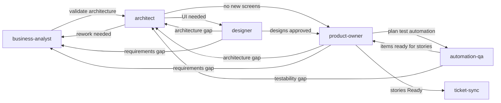
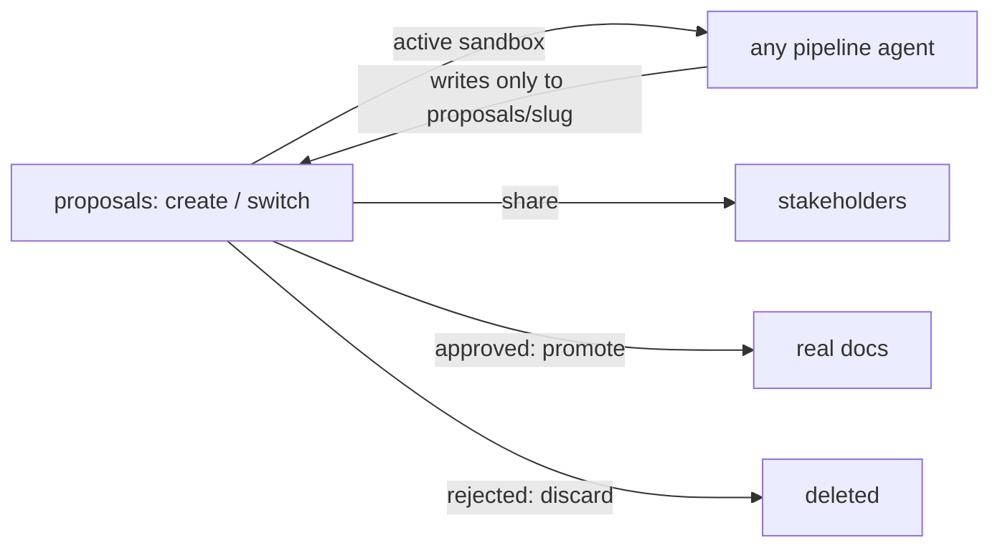

# Sdlc.Planner

Sdlc.Planner is a reusable AI harness for tracking a project end-to-end: from a project initiation document, to structured requirements, to a technical architecture, to UI designs, to plannable user stories synced into your ticket tracker (Jira or Kaneo).

## Setup (first time after cloning)

Everything works out of the box except the **ticket-sync** agent, which needs to know which ticket tracker you use:

1. Open [tickets/config.md](tickets/config.md), set `Provider:` to `jira` or `kaneo`, and fill in that provider's section (project key / workspace / project, etc.).
2. Run the **ticket-sync** agent. It reads the matching adapter in `.github/trackers/<provider>.md`, and if the tracker's MCP server is missing from `.vscode/mcp.json` it offers to add it for you. Jira needs Podman (or Docker) plus an Atlassian email and API token; Kaneo needs its MCP endpoint and OAuth sign-in. VS Code prompts for credentials when the server first starts.

Everything else (agents, instructions, skills) is repo-relative and needs no configuration.
## Folder Structure

| Path | What it's for |
|---|---|
| [pid.md](pid.md) | Start here — a one-time Project Initiation Document: background, objectives, scope, stakeholders, constraints. Fill this in first for a new project. |
| [project-overview.md](project-overview.md) | Living high-level view of the project, seeded from `pid.md` and maintained as `reqs/`/`architecture.md` evolve. |
| `reqs/` | One Markdown file per application domain (`reqs/<domain>.md`), describing what that part of the system needs to do. Copy `reqs/_template.md` for new domains. |
| `architecture.md` | The current technical architecture — tech stack, diagrams, API shapes, deployment — kept in sync with `reqs/`. |
| [proposals/](proposals/readme.md) | Isolated brainstorming workspaces (one folder per idea) — shareable with stakeholders, discardable, and promoted into the real docs only on your approval. |
| [technical-decisions/](technical-decisions/readme.md) | One file per significant technical decision (the "why" behind `architecture.md`) — accepted decisions constrain what the architect and business-analyst agents can assume. Date-based file names avoid merge conflicts. |
| [risk-log/](risk-log/readme.md) | One file per project risk (Business/Technical/Delivery/Compliance), tracked with status and mitigation — seeded from `pid.md`'s initial `Risks` section. |
| `designs/` | HTML+Tailwind screen/component mockups (with screenshots), organized by domain (shared patterns under `designs/_shared/`). `designs/design.md` is the brand & UI system reference every mockup must stay consistent with. |
| `userstories/` | User stories derived from `reqs/`, `architecture.md`, and any approved `designs/`, organized by domain. Each story follows the template in `.github/instructions/user-stories.instructions.md`. |
| `qa/` | One test-automation plan per domain (`qa/<domain>.md`): the critical journeys worth automating and the candidate automation work items the product-owner turns into enabler stories. Automation-layer only — developer unit tests stay in the stories themselves. |
| [tickets/](tickets/config.md) | Ticket-tracker config (config.md) plus sync bookkeeping (groups.md, 
etirements.md) used by the ticket-sync agent. |
| .github/agents/ | The seven custom agents described below. |
| .github/trackers/ | One adapter per supported ticket tracker (Jira, Kaneo) mapping the neutral ticket-sync operations to that tracker's MCP tools. |
| `.github/instructions/` | Conventions that auto-apply when working in matching files (e.g. the user story template applies under `userstories/`). |

## How to Use the Agents

Switch agents from the agent picker in the Chat view (not the default agent) so the right instructions and tool scope apply. There are seven: six pipeline agents, used roughly in this order for a new piece of work, plus **proposals** for brainstorming (see below):

1. **business-analyst** — give it a raw idea in your own words. On a fresh project it reads `pid.md` first for context. It figures out which domain the idea belongs to (or proposes a new one), checks feasibility against existing requirements and `architecture.md`, flags gaps/missing dependencies, and writes/updates `reqs/<domain>.md`.
2. **architect** — reads `reqs/`, validates it against the current `architecture.md`, and updates the architecture to match (new sections, diagrams, tech choices).
3. **designer** — reads `reqs/` and `architecture.md`, and designs screens/shared components as HTML+Tailwind mockups under `designs/`, maintaining `designs/design.md` as the brand & UI system reference. Runs for any domain with a UI, before the product-owner drafts stories.
4. **product-owner** — reads `reqs/`, `architecture.md`, and any approved `designs/`, and drafts/updates user stories under `userstories/`, following the INVEST/Definition-of-Ready quality bar.
5. **automation-qa** — reads the domain's drafted stories and plans the test automation around them in `qa/<domain>.md`: which journeys get automated at which layer (Playwright E2E/visual, backend API/contract), plus harness, CI wiring, test data, and testability hooks. It never writes stories or edits a story's acceptance criteria — the product-owner turns each of its items into an enabler story in the same domain folder.
6. **ticket-sync** — syncs `Status: Ready`+ stories from `userstories/` into the configured ticket tracker (Jira or Kaneo — chosen in `docs/tickets/config.md`) as Stories with per-domain groups (Epics) and Sub-tasks, and pulls issue status back into the story files. Never authors or edits story content.

Each agent stays in its own lane (business-analyst only edits `reqs/`, architect only edits `architecture.md`, designer only edits `designs/`, product-owner only edits `userstories/`, automation-qa only edits `qa/`, ticket-sync only edits the `Status`/`Ticket:` bookkeeping on a story, proposals only edits `proposals/` until it promotes an approved proposal) and hands off to the next one when its part is done — you'll see handoff buttons appear after a response, so the right context carries over rather than manually switching agents:

Automation planning is a round trip: the product-owner drafts the feature stories, automation-qa plans the suite against them, and the product-owner then drafts one enabler story per automation item before the domain is synced to the ticket tracker.

Design is the default next step after architecture for any domain with a UI, but not a hard gate — the architect can hand off straight to the product-owner for backend/infra-only domains (e.g. CI/CD pipeline or project-scaffolding stories) that have no screens. Agents ask clarifying questions for anything high-impact or hard to reverse; smaller assumptions are made and documented inline (in `Open Questions / Assumptions`, `Assumptions & Open Questions`, a design's `Assumptions` section, or a story's `Notes:` section, respectively) so you can review them later instead of being interrupted for every minor detail.

Every story has a `Status` that moves `Draft` → `Ready` → `In Progress` → `Done`. Once a story is `In Progress` or `Done`, its content is locked (it's a record of what was actually built); further changes go into a new continuation story (`<slug>-2.md`) linked back to the original instead of editing it.

## Brainstorming with Proposals

Use the **proposals** agent when you want to explore an idea without committing to it:

1. Ask the proposals agent to *create* a proposal (e.g. "new proposal: bulk-export"). It creates `proposals/<slug>/` and makes it the active one (stored in the git-ignored `proposals/.active`).
2. Switch to any other agent (business-analyst, architect, designer, product-owner, automation-qa) and work as usual. While a proposal is active, they write only inside `proposals/<slug>/` (mirroring the real `docs/` layout) and start every reply with `Proposal: <slug>`. ticket-sync ignores proposals entirely.
3. Ask the proposals agent to *share* it to get a stakeholder one-pager (`share.md`) plus the mockups to show.
4. Run several ideas in parallel by *switching* the active proposal, or *leave* proposal mode to work on the real docs.
5. When an idea is approved, ask the proposals agent to *promote* it: it shows a plan, merges the content into the real docs on your confirmation (stories land as `Draft`), and deletes the proposal folder. Rejected ideas are simply *discarded*.

